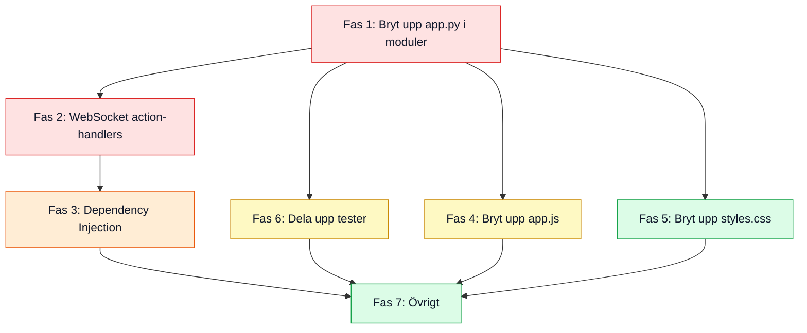

# Refactoring-plan – Riskmatris Live

> **Datum:** 2026-11-01
> **Scope:** Hela kodbasen (≈ 5 900 rader totalt i 5 källfiler)

## Nulägessammanfattning

Projektet är en Python/FastAPI-backend med en vanilla-JS/HTML/CSS-frontend, allt i en enda katalognivå:

| Fil | Rader | Roll |
|-----|------:|------|
| `app.py` | 1 081 | **All** backend-logik: config, DB, models, rate limiting, WS-tickets, WebSocket-manager, alla API-endpoints, SPA-routing |
| `static/app.js` | 1 363 | **All** frontend-logik: state, routing, WS, rendering av 5 vyer, PNG-export |
| `static/styles.css` | 1 858 | **Alla** stilar i en enda platt fil |
| `static/index.html` | 570 | Hela SPA-skalet |
| `tests/test_app.py` | 1 016 | All testlogik i en enda fil |

Koden är välskriven, väldokumenterad och har bra testtäckning – men hela backend:en lever i **en enda fil** (`app.py`, 1 081 rader) och hela frontend:en i **en enda JS-fil** (`app.js`, 1 363 rader). Det gör navigering, återanvändning och parallellt arbete svårt i takt med att appen växer.

---

## Fas 1 – Backend: Bryt upp `app.py` i moduler

> [!IMPORTANT]
> Detta är den viktigaste åtgärden. Filen blandar konfiguration, databas-access, domänlogik, WebSocket-hantering, HTTP-endpoints och SPA-routing i en enda 1 081 rader lång fil.

### Förslag på modulstruktur

```
riskmatris/
├── __init__.py              # FastAPI app-instans + lifespan
├── config.py                # Env-parsing, konstanter, labels
├── models.py                # Pydantic-modeller (CreateSessionRequest, etc.)
├── db.py                    # SQLite init/load/save/cleanup
├── session.py               # Session-logik: create, generate_id, threshold, risk stats
├── rate_limit.py            # In-memory rate limiter
├── ws_tickets.py            # WS ticket create/consume/cleanup
├── ws_manager.py            # ConnectionInfo + SessionConnectionManager
├── routes/
│   ├── __init__.py
│   ├── api.py               # REST-endpoints (sessions, QR, CSV-export)
│   ├── ws.py                # WebSocket endpoint + action handlers
│   └── spa.py               # SPA catch-all + cache-busting
├── utils.py                 # sanitize_user_text, round_half_up, get_risk_level, get_local_lan_ip, _safe_int
```

### Konkreta steg

| # | Åtgärd | Motivering |
|---|--------|------------|
| 1.1 | Extrahera `config.py` | Alla env-variabler, `_parse_env_int`, labels, konstanter. Importeras av allt annat. |
| 1.2 | Extrahera `models.py` | `CreateSessionRequest` och framtida request/response-modeller. |
| 1.3 | Extrahera `utils.py` | Rena hjälpfunktioner utan beroenden: `sanitize_user_text`, `round_half_up`, `get_risk_level`, `_safe_int`, `get_local_lan_ip`. |
| 1.4 | Extrahera `db.py` | `init_db`, `load_sessions_from_db`, `save_session_to_db`, `cleanup_expired_sessions`. `SESSIONS`-dict:en bör leva här (eller i ett delat state-objekt). |
| 1.5 | Extrahera `session.py` | `generate_session_id`, `create_new_risk`, `get_session_threshold`, `compute_risk_stats`. |
| 1.6 | Extrahera `rate_limit.py` | `SESSION_CREATE_LOG`, `check_session_create_rate`, `cleanup_rate_limit_log`. |
| 1.7 | Extrahera `ws_tickets.py` | `WS_TICKETS`, `create_ws_ticket`, `consume_ws_ticket`, `cleanup_expired_ws_tickets`. |
| 1.8 | Extrahera `ws_manager.py` | `ConnectionInfo` + `SessionConnectionManager`-klassen. |
| 1.9 | Skapa `routes/api.py` | REST-endpoints: `create_session`, `get_session_info`, `get_ws_ticket`, `get_session_qr_svg`, `export_session_csv`, `health_check`. |
| 1.10 | Skapa `routes/ws.py` | WebSocket-endpoint + action dispatch. Bryt ut action-hanterarna till namngivna funktioner istället för en 200-raders if/elif-kedja. |
| 1.11 | Skapa `routes/spa.py` | `serve_spa` + `get_static_version` + cache-headers-middleware. |
| 1.12 | Skapa `riskmatris/__init__.py` | FastAPI-instans, lifespan, montera routers + static. Entrypoint: `uvicorn riskmatris:app`. |
| 1.13 | Uppdatera `Dockerfile` & `entrypoint` | Ändra `uvicorn app:app` → `uvicorn riskmatris:app`. |

> [!TIP]
> Gör stegen inkrementellt – kör testerna efter varje extrahering så att inget går sönder.

---

## Fas 2 – Backend: WebSocket-handlern

> [!WARNING]
> `websocket_endpoint()` (rad 753–1043) är en 290-raders funktion med en lång if/elif-kedja (12 grenar). Det är det svåraste att underhålla.

| # | Åtgärd | Motivering |
|---|--------|------------|
| 2.1 | Bryt ut varje WS-action till en egen `async`-funktion | `handle_vote()`, `handle_reveal_now()`, `handle_set_label()`, etc. Funktionerna tar emot `(session, active_risk, msg, conn, manager)` och returnerar om broadcast behövs. |
| 2.2 | Skapa ett action-dispatch dict | `ACTIONS = {"vote": handle_vote, "reveal_now": handle_reveal_now, ...}` – eliminerar if/elif-kedjan. |
| 2.3 | Separera admin-actions från participant-actions | Två separata dicts: `PARTICIPANT_ACTIONS` och `ADMIN_ACTIONS`. Behörighetskontroll sker en gång. |

---

## Fas 3 – Shared state → Dependency Injection

| # | Åtgärd | Motivering |
|---|--------|------------|
| 3.1 | Sluta använda globala `SESSIONS`, `SESSION_CREATE_LOG`, `WS_TICKETS` | Samla allt mutable state i en `AppState`-klass som skapas i `lifespan` och injiceras via FastAPI:s dependency injection (`request.app.state`). Gör koden testbar utan `monkeypatch`. |
| 3.2 | Undvik `global SESSIONS` i lifespan | Idag muteras en modul-global dict – med ett state-objekt försvinner `global`-satsen. |

---

## Fas 4 – Frontend: Bryt upp `app.js`

> [!IMPORTANT]
> 1 363 rader JavaScript i en enda IIFE. All state, alla DOM-refs, rendering, WebSocket-hantering, PNG-export – allt i en fil.

### Förslag på modulstruktur (ES modules)

```
static/
├── js/
│   ├── main.js              # Init, routing, entry point
│   ├── state.js             # Application state (currentSession, selectedProb, etc.)
│   ├── api.js               # fetch-anrop (createSession, enterSession, fetchWsTicket)
│   ├── ws.js                # WebSocket connect/reconnect/send
│   ├── dom.js               # DOM element references (querySelectorAll etc.)
│   ├── render/
│   │   ├── session.js       # handleSessionState – huvudflödet
│   │   ├── sidebar.js       # renderSidebarRiskList
│   │   ├── voting.js        # renderVotingControls, renderAdminVotingControls
│   │   ├── matrix.js        # renderActiveRiskMatrix
│   │   ├── summary.js       # renderSummaryMatrix, renderSummaryTable
│   │   └── header.js        # renderActiveRiskHeader
│   ├── export-png.js        # exportSummaryMatrixAsPng + drawRoundedRect (180 rader)
│   ├── clipboard.js         # copyTextToClipboard
│   └── utils.js             # getCellMeta, escapeHtml, getClientId, getAdminToken, saveRecentSession
```

| # | Åtgärd | Motivering |
|---|--------|------------|
| 4.1 | Konvertera IIFE till ES modules | Byt från `(() => { ... })()` till `import`/`export`. Moderna webbläsare stödjer `<script type="module">`. |
| 4.2 | Extrahera PNG-exporten | `exportSummaryMatrixAsPng` + `drawRoundedRect` (≈ 180 rader) är helt fristående canvas-logik. |
| 4.3 | Extrahera render-funktionerna | De 6 render-funktionerna (sidebar, voting, matrix, summary, header, admin) är tydliga enheter. |
| 4.4 | Extrahera WebSocket-logiken | Connect/reconnect/send + ticket-hämtning. |
| 4.5 | Extrahera state | Mutable app-state i ett eget modul → enklare att testa och spåra. |
| 4.6 | Extrahera `getCellMeta` | Duplicerad logik med backend:ens `get_risk_level`. Överväg att bara beräkna detta server-side och skicka i payloaden. |
| 4.7 | Uppdatera `index.html` | `<script type="module" src="/static/js/main.js">`. |
| 4.8 | Uppdatera cache-busting | `get_static_version()` behöver hasha alla filer i `static/js/`. |

> [!NOTE]
> Om du vill ha ett enklare första steg kan du använda en JS bundler (esbuild/rollup/vite) som ger samma resultat (en enda produktionsfil) men med utvecklarvänlig modulstruktur.

---

## Fas 5 – CSS: Bryt upp `styles.css`

| # | Åtgärd | Motivering |
|---|--------|------------|
| 5.1 | Dela upp per sektion | `base.css`, `topbar.css`, `landing.css`, `session.css`, `voting.css`, `matrix.css`, `modal.css`, `table.css`, `responsive.css`. Ladda via `@import` eller bundla. |
| 5.2 | Ta bort duplicerad block | `.admin-vote-panel` deklareras identiskt på **rad 639–643** och **rad 649–653**. Ta bort den ena. |
| 5.3 | Konsolidera `.vote-option-btn` | Tre separata selectors som sätter `min-height: 76px` (rad 1137–1138, 1186–1189, 1206–1208). Behöver bara finnas en gång. |

---

## Fas 6 – Tester: Bryt upp `test_app.py`

| # | Åtgärd | Motivering |
|---|--------|------------|
| 6.1 | Dela upp i filer som matchar modulerna | `tests/test_config.py`, `tests/test_session.py`, `tests/test_utils.py`, `tests/test_rate_limit.py`, `tests/test_ws_tickets.py`, `tests/test_api.py`, `tests/test_ws.py`, `tests/test_spa.py`. |
| 6.2 | Skapa en `conftest.py` | Gemensamma fixtures: `test_client`, `test_session`, `tmp_db_path`. Eliminerar duplicerad `_add_session()`/`_make_session()`-logik som idag kopieras i flera testklasser. |
| 6.3 | Lägg till testning av WebSocket-actions | Idag testas bara disconnect; samtliga 12 WS-actions saknar enhetstester. |

---

## Fas 7 – Övriga förbättringar

| # | Åtgärd | Motivering |
|---|--------|------------|
| 7.1 | Typade datamodeller för session/risk | Idag är session och risk `dict[str, Any]` – svårt att veta vilka nycklar som finns. Konvertera till Pydantic-modeller eller dataclasses. |
| 7.2 | Eliminera duplicerad risk-level-logik | `getCellMeta()` i JS och `get_risk_level()` i Python har identisk logik. Servern kan skicka `color` och `level` i payloaden (den gör det redan delvis) – frontend behöver bara läsa värdena. |
| 7.3 | Asynkron DB | `sqlite3`-anrop blockerar event-loopen. Överväg `aiosqlite` eller kör DB-operations i en threadpool. |
| 7.4 | Fler Pydantic-modeller för WS-meddelanden | Varje WS-action valideras manuellt med `_safe_int()` – Pydantic-modeller ger automatisk validering och bättre felmeddelanden. |
| 7.5 | Structured logging | Byt till JSON-formaterat loggning (t.ex. `structlog`) för enklare filtrering i produktion. |
| 7.6 | OpenAPI-schema | FastAPI genererar OpenAPI automatiskt men alla endpoints saknar `response_model`. Lägg till response-modeller för bättre dokumentation. |

---

## Prioritetsordning



> [!TIP]
> **Fas 1 + 2** ger störst effekt med lägst risk – det är ren omstrukturering utan beteendeändringar. Kör testerna efter varje steg för att verifiera att inget går sönder.

---

## Vad som **inte** behöver ändras

Följande är redan bra och bör behållas som det är:

- ✅ Säkerhetsdesignen (rate limiting, input sanitization, WS tickets, timing-safe jämförelser)
- ✅ Separation av admin/participant med ticket-baserad WS-autentisering
- ✅ Befintlig testsvit – bra täckning av kärnlogik
- ✅ Docker/deploy-setup (Dockerfile, docker-compose, Traefik, devcontainer)
- ✅ Kodkvalitet och kommentarer – väldokumenterat med tydliga motiveringar
- ✅ Cache-busting med content-hash
